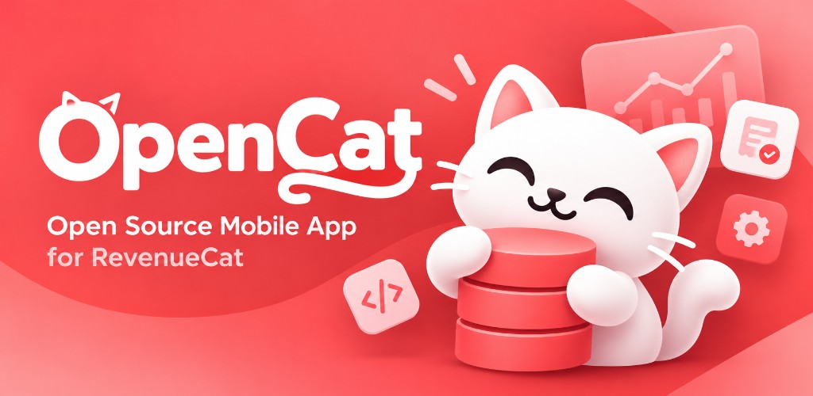

<div align="center">



# OpenRC

**Your RevenueCat revenue, beautifully, on every device.**

An open-source dashboard for [RevenueCat](https://www.revenuecat.com) on iPhone, iPad, Android, Mac and the web.<br>
Every sale as it happens, this month's revenue, your next payout, and the charts that matter.

[](https://github.com/stackwares/openrc/actions/workflows/ci.yml)
[](LICENSE)
[](https://flutter.dev)


<sub>Not the Linux init system of the same name, and not affiliated with RevenueCat, Inc.</sub>

</div>

---

## Why OpenRC

RevenueCat's dashboard is built for analysis at a desk. OpenRC is built for
the question you ask ten times a day: *how are sales going?* It signs in with
your RevenueCat account and works out the answers on your device:

- **Every sale, as it happens.** Today's transactions with app icons,
  products, countries and stores, a running total against yesterday, and a
  seven-day strip to step back through the week.
- **What each sale is.** New subscriptions, renewals, trials, conversions,
  refunds and cancellations, counted and filterable, with each subscriber's
  tenure.
- **Revenue you'll actually receive.** Optionally net of App Store and Google
  Play fees, with your own fee rates, in any of 100 display currencies.
- **When you'll get paid.** Upcoming App Store and Google Play payouts, using
  Apple's fiscal calendar.
- **Where the money comes from.** Breakdowns by store, new vs. renewals, top
  apps and top countries, for any day or the month so far.
- **The charts that matter.** MRR, ARR, revenue, proceeds, subscriptions,
  trials, users, churn and more, over any date range.
- **At a glance.** Home screen widgets on iOS and Android.
- **Made for every screen.** A floating tab bar on phones, a navigation rail
  on tablets, and a sidebar with side-by-side columns, keyboard shortcuts and
  a native menu bar on desktop.

## Download

| Platform | |
|---|---|
| iPhone and iPad | App Store: coming soon |
| Android | Google Play: coming soon |
| Mac | Mac App Store: coming soon |
| Web | [openrc-app.pages.dev](https://openrc-app.pages.dev) |

Or [build it yourself](#build-from-source) in a few minutes.

## Privacy and security

- **Your password goes straight to RevenueCat.** OpenRC signs in through
  RevenueCat's own API, with two-factor codes supported. It never sees or
  stores your password; the session token stays in the device's secure
  storage (Keychain on Apple platforms).
- **No OpenRC server holds your data.** Native apps talk to RevenueCat
  directly. Browsers can't, so the web app goes through a small
  [stateless relay](relay/) that streams requests through without storing or
  logging them. You can run your own.
- **Anonymous, optional usage stats.** Official builds send crash reports and
  which screens are used to [PostHog](https://posthog.com), never your
  account, apps or revenue, and you can turn it off in Settings. Builds from
  source send nothing unless you add your own PostHog key.

Found a vulnerability? Please report it privately; see [SECURITY.md](SECURITY.md).

## Build from source

You need [Flutter](https://docs.flutter.dev/get-started/install) 3.47 or
later, plus Xcode for iOS and macOS or Android Studio for Android.

```bash
git clone https://github.com/stackwares/openrc.git
cd openrc
flutter pub get
flutter run
```

Pick a device with `flutter devices`. Sign in with your RevenueCat dashboard
email and password.

### Web

The web app needs the relay. Run it locally ([details](relay/README.md)):

```bash
cd relay && npm install && cp .dev.vars.example .dev.vars && npm run dev
```

Then, from the project root:

```bash
flutter run -d chrome --dart-define=OPENRC_RELAY_URL=http://127.0.0.1:8787
```

### Configuration

Everything is optional and set with `--dart-define` (or
`--dart-define-from-file`):

| Define | What it does |
|---|---|
| `OPENRC_RELAY_URL` | Relay the web app uses. Defaults to the official one. |
| `POSTHOG_PROJECT_TOKEN` | Enables anonymous crash reports and usage stats. Off when empty. |
| `POSTHOG_HOST` | PostHog ingestion host. Defaults to `https://us.i.posthog.com`. |

`dart_defines/posthog.example.json` shows the file format. Shipping builds
to testers and the web is covered in [docs/RELEASING.md](docs/RELEASING.md).

## How it works

OpenRC uses the same developer API as RevenueCat's own dashboard. It pages
through your transactions and recomputes what the dashboard doesn't show:
day totals in your time zone, revenue after store fees, payout dates, currency
conversion, subscriber tenure and per-type counts. Read
[docs/ARCHITECTURE.md](docs/ARCHITECTURE.md) for the tour.

```
lib/
  app/        app shell, navigation, menu bar
  features/   transactions, revenue, charts, settings, sign-in
  services/   RevenueCat API and auth, stores, telemetry
  models/     API models
  theme/      tokens, colors, typography
  widgets/    shared UI
relay/        Cloudflare Worker that lets the web app reach RevenueCat
```

## Contributing

Bug reports, ideas and pull requests are welcome. Start with
[CONTRIBUTING.md](CONTRIBUTING.md), and please follow the
[code of conduct](CODE_OF_CONDUCT.md).

## Acknowledgements

- [Kedi](https://github.com/sereisoglu/Kedi) by Saffet Emin Reisoğlu, the
  native iOS RevenueCat client whose approach to the API, payout calendar and
  transaction paging OpenRC follows.
- [RevenueCat](https://www.revenuecat.com), for the platform this is built on.
- [Flutter](https://flutter.dev), [Riverpod](https://riverpod.dev),
  [FlexColorScheme](https://docs.flexcolorscheme.com) and
  [fl_chart](https://github.com/imaNNeo/fl_chart).

## License

[MIT](LICENSE). RevenueCat is a trademark of RevenueCat, Inc. OpenRC is an
independent project and is not affiliated with or endorsed by RevenueCat.
